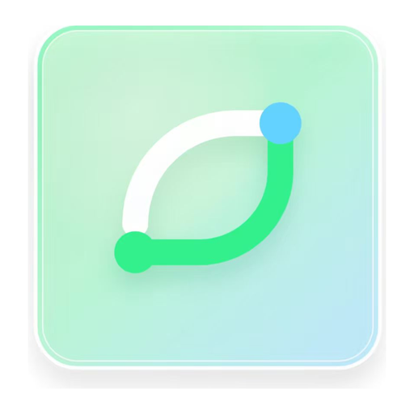
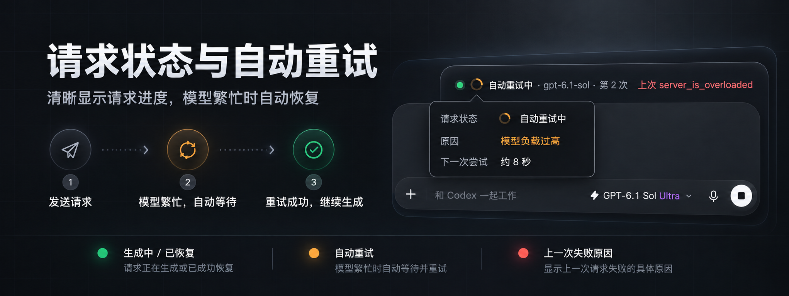
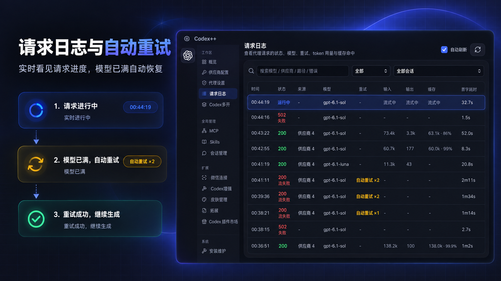
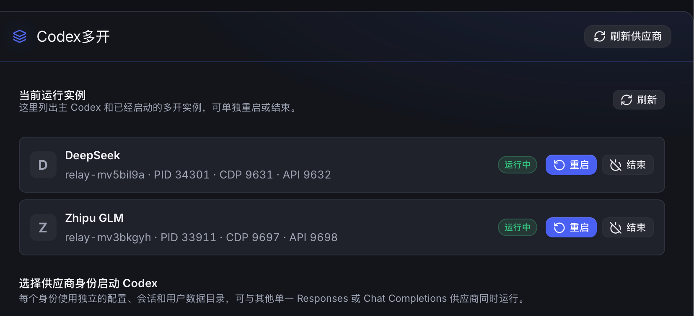

<p align="center">
  
</p>

<p align="center">
  <strong>给 Codex 桌面应用加一点「++」。</strong><br>
  统一管理供应商与模型，让会话更好用，也让工作区更像你。
</p>

<p align="center">
  <a href="https://github.com/BigPizzaV3/CodexPlusPlus/releases"></a>
  <a href="https://github.com/BigPizzaV3/CodexPlusPlus/stargazers"></a>
  <a href="LICENSE"></a>
  
  
</p>

<p align="center">
  <a href="https://github.com/BigPizzaV3/CodexPlusPlus/releases"><strong>下载最新版 ↗</strong></a> &nbsp; · &nbsp;
  <a href="#快速上手">快速上手</a> &nbsp; · &nbsp;
  <a href="#功能一览">功能一览</a> &nbsp; · &nbsp;
  <a href="https://github.com/BigPizzaV3/CodexPlusPlus/issues">反馈问题</a> &nbsp; · &nbsp;
  <a href="README_EN.md">English</a>
</p>

<p align="center">
  
  <br><sub>从供应商配置到界面增强，一个管理工具就够了。</sub>
</p>

Codex++ 是面向 OpenAI Codex / ChatGPT 桌面应用的统一管理应用，通过 CDP 与内置运行服务提供供应商切换、协议转换、会话管理和界面增强。双击打开配置界面，再从界面启动官方应用。它不修改官方应用的 `app.asar`，也不向安装目录写入补丁文件。

## 交流与支持

遇到问题请通过 [GitHub Issues](https://github.com/BigPizzaV3/CodexPlusPlus/issues) 提交，附上系统、Codex++ 版本、复现步骤与已脱敏的日志。欢迎分享拓展、主题和使用经验。

<p align="center">
  <a href="https://qm.qq.com/q/5h3pxpxg7S">QQ 交流 4 群 · 1127858981</a> &nbsp; · &nbsp;
  <a href="https://t.me/CodexPlusPlus">Telegram 频道</a> &nbsp; · &nbsp;
  <a href="https://linux.do">LINUX DO</a>
</p>

## 感谢赞助商

感谢以下赞助商对项目的支持。服务范围、价格与活动以各平台官网说明为准。

<p align="center">
  <a href="https://jojocode.com/">
    
  </a>
</p>

<p align="center">
  <a href="https://jojocode.com/"><strong>JOJO Code</strong></a><br>
  JOJO Code 提供稳定、价格合理的 API 中转服务，支持 GPT-6.1、GPT-6、Fable 5.1、Claude Opus 5.5 等模型与图像能力，适合日常开发、团队协作和长期项目工作流。
</p>

<table>
  <tr>
    <th width="180">🏆 赞助商 🏆</th>
    <th>介绍</th>
  </tr>
  <tr>
    <td align="center">
      <a href="https://jojocode.com/">
        
      </a>
    </td>
    <td><a href="https://jojocode.com/"><strong>JOJO Code</strong></a><br>JOJO Code 提供稳定、价格合理的 API 中转服务，支持 GPT-6.1、GPT-6、Fable 5.1、Claude Opus 5.5 等模型与图像能力，适合日常开发、团队协作和长期项目工作流。</td>
  </tr>
  <tr>
    <td align="center">
      <a href="https://apikey.fun/register?aff=CODEX">
        
      </a>
    </td>
    <td><a href="https://apikey.fun/register?aff=CODEX"><strong>APIKEY.FUN</strong></a><br>感谢 APIKEY.FUN 赞助了本项目！APIKEY.FUN 是一家致力于提供开放、稳定、高性价比的全球主流大模型的 AI 中转站。平台支持 Claude、OpenAI、Gemini 等热门模型的 API 中转服务，价格低至官方原价的 7%。通过专属链接<a href="https://apikey.fun/register?aff=CODEX">注册 APIKEY</a>，可享受最高充值永久 95 折优惠。</td>
  </tr>
  <tr>
    <td align="center">
      <a href="https://runapi.host/register?aff=AWJq">
        
      </a>
    </td>
    <td><a href="https://runapi.host/register?aff=AWJq"><strong>RunAPI</strong></a><br>RunAPI 是高效稳定的 API 聚合平台，一个 API Key 即可访问 OpenAI、Claude、Gemini、DeepSeek、Grok 等 150+ 主流模型，低至 1 折，兼容 Claude Code、OpenClaw 等工具。</td>
  </tr>
  <tr>
    <td align="center">
      <a href="https://api.fenno.ai/s/ZZM7">
        
      </a>
    </td>
    <td><a href="https://api.fenno.ai/s/ZZM7"><strong>FennoAI</strong></a><br>FennoAI 是一家稳定、高效的 API 中转服务商，目前主要提供 Codex 中转服务，兼容 OpenAI 及 Anthropic 协议，可灵活接入 Codex、Claude Code、OpenCode 等主流编程工具，稳定支撑千亿 Token/日的企业级调用需求，支持国内及海外主体公对公结算、开票。通过<a href="https://api.fenno.ai/s/ZZM7">专属链接</a>购买订阅，仅需 1.99 美元即可获得价值 50 美元的 Coding Plan 额度；邀请好友购买最高可获得 20% 返佣。</td>
  </tr>
  <tr>
    <td align="center">
      <a href="https://cn.hb-api.online/register?aff=8KA2ZKWNHND8">
        
      </a>
    </td>
    <td><a href="https://cn.hb-api.online/register?aff=8KA2ZKWNHND8"><strong>百可为AI</strong></a><br>百可为AI 是面向开发者、团队和 AI 工具用户的一站式大模型 API 服务平台，支持 Claude、OpenAI、Gemini、Codex 等主流模型能力接入。平台提供稳定中转、灵活计费、用量统计、余额管理和多场景 API 调用能力，适合 Claude Code、Codex、AI 生图、自动化脚本和各类智能应用长期使用。新用户注册可领取免费额度，开发者可快速接入、即开即用，让 AI 能力更稳定、更高效、更省心。</td>
  </tr>
  <tr>
    <td align="center">
      <a href="https://s.qiniu.com/7zUJri">
        
      </a>
    </td>
    <td><a href="https://s.qiniu.com/7zUJri"><strong>七牛云</strong></a><br>感谢七牛云 AI 赞助本项目！七牛云 AI 是七牛云（02567.HK）旗下企业级大模型 MaaS 平台，可一站式调用全球 150 多个主流模型，兼容全球主流模型厂商协议，覆盖文本、图像、音频、视频、文件处理等全模态能力，服务超过 169 万企业及开发者用户。企业用户可免费领取 1200 万 Token，邀请好友最高可获得百亿 Token。</td>
  </tr>
  <tr>
    <td align="center">
      <a href="https://agent.tokenmy.ai">
        
      </a>
    </td>
    <td><a href="https://agent.tokenmy.ai"><strong>TokenMy</strong></a><br>感谢 TokenMy 赞助本项目！TokenMy 是面向开发者与团队的统一 AI 模型 API 网关，汇聚 OpenAI、Anthropic、Google、DeepSeek、字节跳动、Suno 等厂商的模型，覆盖 GPT、Claude、Gemini 等对话模型，GPT Image 生图模型，Seedance、Veo 视频模型及 Suno 音乐生成模型。一个 API Key 即可接入多类 AI 能力，配合按量计费、用量监控与账单查询，满足智能体开发、多模态应用与影音内容创作需求。欢迎<a href="https://agent.tokenmy.ai">注册使用</a>，也可申请成为 TokenMy 代理或推广大使，携手拓展 AI 应用市场，享受推广佣金与合作激励。</td>
  </tr>
  <tr>
    <td align="center">
      <a href="https://apinebula.ai/ref/IiCBg1nu">
        
      </a>
    </td>
    <td><a href="https://apinebula.ai/ref/IiCBg1nu"><strong>APINEBULA</strong></a><br>感谢 APINEBULA 赞助本项目！APINEBULA 是银河录像局旗下的企业级 AI 聚合平台，背靠大平台资源，面向开发者、团队与企业用户提供稳定、高性价比的大模型 API 接入服务。平台聚合 Claude、GPT、Gemini 等主流满血模型，一个接口接入全球顶尖 AI 大模型，各大模型价格低至 1 折起，支持企业级高并发、正式合同、对公打款与开票服务，适合 AI 编程、Agent 开发、业务系统集成等多种场景！<a href="https://apinebula.ai/ref/IiCBg1nu">使用此链接注册</a>并在充值时填写「PLUSPLUS」优惠码可享九折优惠！</td>
  </tr>
</table>

想支持项目或展示品牌？[联系维护者](mailto:1727532@qq.com)。

## 功能一览

<table>
  <tr>
    <td width="50%" valign="top">
      <h3>🔌 供应商自由切换</h3>
      官方登录、官方登录 + API、纯 API 与聚合供应商（故障转移 / 模型聚合）。支持 Responses / Chat Completions、模型测试与 Provider Doctor。
    </td>
    <td width="50%" valign="top">
      <h3>🧠 每个模型，各有空间</h3>
      按模型设置上下文窗口与自动压缩阈值，支持模型元数据导入；按供应商选择 MCP、Skill 和 Plugin。
    </td>
  </tr>
  <tr>
    <td valign="top">
      <h3>🖱️ Computer Use 共享 · 新</h3>
      把 Codex 自带的 Computer Use 与 Chrome 浏览器控制，通过 MCP 接给 Claude Code、Claude Desktop、DeepSeek Harness 等客户端，审批方式可选。
    </td>
    <td valign="top">
      <h3>🤖 不止 Codex · 新</h3>
      Claude Code 供应商一键切换（CC Switch 风格，支持从第三方导入）；Claude 增强版提供中文界面、语音输入与 Computer Use；另可管理 Grok CLI。
    </td>
  </tr>
  <tr>
    <td valign="top">
      <h3>🛡️ 请求避震与请求日志</h3>
      上游过载时在代理层自动退避重试，可按 HTTP 状态码选择重试；请求日志实时显示进行中的请求、首字耗时、重试原因与 Token 用量，可按会话筛选。
    </td>
    <td valign="top">
      <h3>🤝 子 Agent 协作</h3>
      在 Codex 对话中用自然语言委派 Codex CLI、DeepSeek Harness（dsh）或 Claude Code，执行结果回到当前对话。
    </td>
  </tr>
  <tr>
    <td valign="top">
      <h3>💬 会话管理更省心</h3>
      本地会话扫描、删除与撤销、批量管理、Markdown 导出、Token 历史与项目移动；实验性<a href="docs/turn-rewind.md">轮次回退</a>，侧聊可保存为普通会话。
    </td>
    <td valign="top">
      <h3>🧵 Codex 多开</h3>
      为每个供应商身份启动相互隔离的 Codex 实例，配置、会话和用户数据目录各自独立，可单独重启或结束。
    </td>
  </tr>
  <tr>
    <td valign="top">
      <h3>✨ 输入与阅读，都顺手</h3>
      语音输入（含全局快捷键）、粘贴修复、会话宽度、滚动位置恢复、下一步建议、回答大纲与光标打字特效。
    </td>
    <td valign="top">
      <h3>📊 用量状态栏</h3>
      输入框下方实时显示生成速度、缓存命中率和上下文占用，口径与 Codex 一致，默认开启。
    </td>
  </tr>
  <tr>
    <td valign="top">
      <h3>⚡ 纯 API Key 也能用原生 Fast</h3>
      按需解锁 Codex 原生 Standard / Fast 控件；默认关闭，实际支持与计费以供应商为准。
    </td>
    <td valign="top">
      <h3>🧩 拓展你的工作区</h3>
      浏览与管理社区用户脚本，另有 MCP、Skill（支持分组与批量管理）与 Codex 插件管理。
    </td>
  </tr>
  <tr>
    <td valign="top">
      <h3>📱 微信连接</h3>
      扫码连接本机 Codex，每个联系人映射到独立会话，并可配置允许访问的微信用户。
    </td>
    <td valign="top">
      <h3>🧹 AI Agent 缓存清理 · 新</h3>
      扫描 Codex、Claude 与 Codex++ 的已知缓存目录，列出占用，由你勾选清理。
    </td>
  </tr>
  <tr>
    <td valign="top">
      <h3>🐳 用量挂件与桌宠 · 开发预览</h3>
      Token 统计、任务状态和预算提醒，可拖动、缩放、更换角色。
    </td>
    <td valign="top">
      <h3>🎨 皮肤与个性化</h3>
      Dream Skin 社区主题、自定义图片覆盖层，让界面更有自己的风格。
    </td>
  </tr>
</table>

所有增强都能单独开关；关闭增强总开关后，供应商与启动管理照常可用。

## 看看它能做什么

### Computer Use：把 Codex 的桌面控制借给其他 Agent

Codex 桌面版（ChatGPT.app）自带 Computer Use 与 Chrome 浏览器控制。Codex++ 把它们包装成两个 MCP 服务（`codex-plus-cu` 桌面操控、`codex-plus-browser` 浏览器控制），接给 Claude Code、Claude Desktop、Codex CLI、DeepSeek Harness、ZCode、WorkBuddy 等客户端，不复制任何官方程序，运行时始终指向本机已安装的 ChatGPT.app。

1. 确认本机已安装并打开过一次 Codex 桌面版，且已授予辅助功能与屏幕录制权限。
2. 在最左栏打开「Computer Use」，在工作原理图左侧给要用的客户端点「接入」；客户端换了配置目录时，可以在下方「配置路径与自定义目录」里登记。
3. 在 `codex-plus-cu` 节点上选择审批方式：「自动放行」只记审计日志，「交给 Claude」由客户端弹卡确认。
4. 重启对应客户端，工具名以 `mcp__codex-plus-cu__` 与 `mcp__codex-plus-browser__` 开头。

写入客户端配置前会自动备份，只改动 Codex++ 自己写入的条目。浏览器控制依赖官方 ChatGPT for Chrome 扩展。目前仅支持 macOS。

### Claude Code 与 Grok，也在同一个地方管

最左栏切换 Agent 即可进入各自的页面：

- **Claude Code 供应商**：参考 CC Switch 的列表与编辑体验，切换时写入 `~/.claude/settings.json`，支持从 cc-switch 等第三方导入。
- **Claude 增强**：保留官方 Claude.app 原样，制作一份独立副本并在启动时注入增强，可分别开关中文界面、输入框语音输入与 Computer Use（Computer Use 暂仅 macOS）。
- **Grok 配置**：管理 Grok CLI 的模型与 API 端点。

### 请求状态、自动重试与请求日志

模型容量不足或暂时过载（`server_overloaded`、`at capacity` 等）时，Codex++ 在代理层自动等待并重试，恢复后继续生成。「代理设置 → 请求避震」可选两种模式：**流式避震**保留实时输出，首字后的过载交给 Codex 原生重试；**整段缓冲避震**先收完整段响应，任何时点的过载都由代理重试（代价是失去流式）。本地协议代理常驻运行，Codex 退出后仍可用。

<p align="center">
  
</p>

「请求日志」记录经过本地代理的每一次请求：状态、模型、重试次数与原因、首字耗时、输入 / 输出 / 缓存 Token，进行中的请求实时更新，可按会话筛选。

<p align="center">
  
</p>

### 输入框下方，用量一目了然

「用量状态栏」实时显示生成速度、缓存命中率和上下文占用。数据取自 Codex 写入的本机会话记录：缓存命中为 `cached_input_tokens / input_tokens`，上下文占用按 Codex 识别到的每模型窗口计算。默认开启，可在「Codex 增强 → 常用增强」关闭。速度包含工具执行时间，读数会低于纯解码速度。

<p align="center">
  
</p>

### 同一台电脑，多个 Codex 互不打扰

「Codex多开」为每个供应商身份启动相互隔离的 Codex 实例。运行中的主 Codex 与多开实例集中在列表里，可单独重启或结束，不影响彼此会话。

<p align="center">
  
</p>

### 在 Codex 对话里，直接请其他 Agent 帮忙

对 Codex 说「让 DeepSeek 实现这个功能」或「让 Claude Code 审核改动」，Codex++ 会通过 MCP 启动对应的原生 CLI，结果回到当前对话。点名时使用对应 Agent，未点名时使用默认 Agent。

1. 打开「Agent 协作」，启用协作及要使用的 Agent，选择默认 Agent 并保存。
2. 点击「一键接入并刷新」，将协作工具接入 Codex。
3. 回到 Codex 对话，直接点名分派任务。

<p align="center">
  
</p>

模型路由、DSH 登录复用与任务配置见 [子 Agent 协作指南](docs/agent-collaboration.md)。

### 纯 API Key，也能使用原生 Fast 控件

1. 打开「Codex 增强 → 常用增强」，开启增强总开关与「原生 Fast 强制解锁」（默认关闭）。
2. 确认模型已声明 Fast 服务等级；需要手动配置时，在「供应商配置」中为该模型设置「Fast（priority）支持」并保存。
3. 从 Codex++ 重新启动 Codex，在模型或推理强度菜单中选择 **⚡ Fast**；选择 **Standard** 即可恢复。

实际可用性、提速效果与计费由供应商决定，开启后不会让所有模型自动提速。

<details>
  <summary><strong>展开查看 Codex 内的增强设置</strong></summary>

<p align="center">
  
</p>

</details>

### 让拓展适应你的工作流

从拓展市场发现社区脚本，为工作区添加用量面板、模型选择器、提示词优化等工具，按需安装、启停，也可以编写自己的脚本。这里的「拓展」是 Codex++ 用户脚本，与 Codex 官方插件市场是两个入口；开发说明见 [用户脚本热重载](docs/user-script-reload.md)。

<p align="center">
  
</p>

### 认真工作，也可以有点趣味

<table>
  <tr>
    <td width="42%" valign="top">
      <strong>用量挂件与桌宠 · 开发预览</strong><br>
      查看本地会话 Token 与任务状态，支持拖动、缩放和更换角色图片。
      <p></p>
    </td>
    <td width="58%" valign="top">
      <strong>光标打字特效</strong><br>
      彩虹粒子、烟花与星光，让输入多一点反馈。可随时关闭，系统减少动态效果时暂停。
      <p></p>
    </td>
  </tr>
</table>

用量挂件在「Codex 增强 → 常用增强 → 挂件与桌宠」开启（默认关闭），包含原版角色、泡泡编辑器、音效与资源管理、余额与额度模板等。使用说明与统计口径见 [Codex 用量挂件](docs/whale-widget.md)，功能核对见 [完整功能验收](docs/whale-parity.md)。

**鲸鱼功能来源与鸣谢：**原始功能、完整界面引擎、鲸鱼角色及内置音效/动图来自 [MeteorNOX/DeepSeek-Balance-Whale-Widget](https://github.com/MeteorNOX/DeepSeek-Balance-Whale-Widget)，本项目将其适配为 Codex++ 内置功能；Codex 桌面版技术路线另参考 [Yang-huai406/Codex-Whale-Public](https://github.com/Yang-huai406/Codex-Whale-Public)。原始代码与素材声明见随项目保留的 [LICENSE](assets/inject/upstream/whale-widget/LICENSE) 和 [PROVENANCE.md](assets/inject/upstream/whale-widget/PROVENANCE.md)，素材不重新声明为本项目原创。

## 快速上手

**1. 下载安装包**：前往 [GitHub Releases](https://github.com/BigPizzaV3/CodexPlusPlus/releases)。

| 你的设备 | 安装包 |
| --- | --- |
| Windows · x64 | `CodexPlusPlus-*-windows-x64-setup.exe` |
| macOS · Apple Silicon / Intel | `CodexPlusPlus-*-macos-universal.dmg` |

**2. 打开 Codex++ 完成配置**：Windows 提供桌面与开始菜单快捷方式，macOS 将 DMG 内的 **Codex++.app** 拖入「应用程序」。首次使用先确认官方应用路径（需已安装 Codex / ChatGPT 桌面应用），再选择供应商，按需开启增强功能。

**3. 在界面中启动 Codex**：点击「启动 Codex」，加载已保存的配置并打开官方应用。依赖注入的设置需要保存后在界面中重启 Codex 才生效。更新可在「关于」页检查，有新版本时左上角 logo 会出现角标，点一下即可更新。

<details>
  <summary><strong>从旧版 macOS 升级</strong></summary>

新发布的 DMG 会保留一个隐藏的兼容壳，让 v1.7.x 的旧更新器可以自动替换两个旧 app；更新后首次启动会自动将兼容壳移到 `~/.codex-session-delete/legacy-migrations`，Applications 中只保留 Codex++。v1.5/v1.6 的旧版本只会打开 DMG，请把其中可见的 **Codex++.app** 拖入「应用程序」替换一次；新版启动时同样会自动归档旧的 **Codex++ 管理工具.app**。原有配置与会话数据继续沿用。

</details>

## 供应商与模型

### 选一种适合你的使用方式

| 模式 | 适用场景 |
| --- | --- |
| **官方登录** | 使用 ChatGPT / Codex 官方账号。 |
| **官方登录 + API** | 保留官方登录状态与插件入口，模型请求始终走配置的兼容 API（不消耗官方额度）。 |
| **纯 API** | 使用自定义 Base URL / Key，无需官方账号。 |
| **聚合供应商** | **故障转移**：在多个供应商之间失败切换，按会话 / 请求 / 权重轮转。**模型聚合**：成员模型合并进 Codex 模型列表，带 `cpx-供应商ID/模型名` 前缀的条目固定发往对应成员。 |

Chat Completions 供应商可通过本地代理转换为 Codex 使用的 Responses 协议。聚合成员既可以是 API 供应商，也可以是已登录的官方账号：代理用该账号的 OAuth 凭据访问官方后端，token 过期时自动刷新，返回 401 时强制刷新后重试一次。供应商还可以配置自动审批模型，改写 Codex 的 `codex-auto-review` 请求。

### 模型选择器：按供应商分组折叠

模型聚合后，原生模型选择器按供应商折叠成组：表头显示供应商名与模型数量，默认成员带「默认」标志，支持「全部展开 / 全部折叠」并记住折叠状态；单供应商保持原生列表不动。

<p align="center">
  
</p>

### 给每个模型设置自己的上下文窗口

在模型列表中使用窗口后缀，支持 `1M`、`200K` 或纯数字：

```text
deepseek-v4-pro[1M]
your-model[200K]
another-model[128000]
```

Codex++ 会生成独立的 `model_catalog_json`，让 Codex 按当前模型使用对应窗口；未指定后缀的模型沿用供应商级配置。请按供应商实际能力填写。

切换供应商时会先保存当前配置，再写入目标配置。API Key 只保存在本机，提交反馈前请隐藏密钥与认证信息。

## 常见问题

<details>
  <summary><strong>启动后，为什么没有 Codex++ 菜单？</strong></summary>

确认在 **Codex++** 界面中点击「启动」打开官方应用。打开「安装维护」与「关于」页面，检查应用路径、启动状态和诊断日志。

</details>

<details>
  <summary><strong>切换供应商后，请求为什么失败？</strong></summary>

先在供应商详情中运行模型测试或 Provider Doctor，确认协议、Base URL、Key 与模型匹配。纯 API 和官方登录 + API 使用不同的认证位置，不要手工复制两种模式的 `auth.json`。

</details>

<details>
  <summary><strong>Computer Use 接入后，客户端里为什么没有工具？</strong></summary>

接入后需要重启对应客户端才会加载工具；Claude Desktop 退出时会重写自己的配置，建议先完全退出再接入。仍然没有时，在「Computer Use」页的「配置路径与自定义目录」里核对客户端实际读取的配置目录，必要时登记自定义路径；并确认已在系统设置里给 ChatGPT 授予辅助功能与屏幕录制权限。

</details>

<details>
  <summary><strong>增强功能可以关闭吗？官方应用更新后还能用吗？</strong></summary>

可以分别关闭，也可以关闭增强总开关。Codex++ 依赖官方桌面应用的页面结构、CDP 和本地数据格式；官方应用更新后，部分功能可能需要跟随适配。修改供应商配置或会话数据前，请保留备份。

</details>

<details>
  <summary><strong>配置、会话和日志存在哪里？</strong></summary>

设置了 `CODEX_HOME` 时，Codex 主目录以该变量为准；否则使用 `~/.codex`。

| 数据 | 位置 |
| --- | --- |
| Codex 配置与登录状态 | `~/.codex/config.toml`、`~/.codex/auth.json` |
| 本地数据库 | 优先 `~/.codex/sqlite/*.db`，旧版回退 `~/.codex/state_5.sqlite` |
| Codex++ 状态与日志 | `~/.codex-session-delete/` |
| Provider 同步备份 | `~/.codex/backups_state/provider-sync` |

</details>

## 一起把「++」做得更好

欢迎修复问题、完善文档、开发拓展，或分享你的使用建议。感谢每一位贡献者，也感谢帮助定位问题、测试版本和支持项目的人。

<p align="center">
  <a href="https://github.com/BigPizzaV3/CodexPlusPlus/graphs/contributors">
    
  </a>
  <br><sub>代码贡献者头像由 <a href="https://contrib.rocks">contrib.rocks</a> 生成，点击查看贡献记录。</sub>
</p>

<details>
  <summary><strong>开发与本地检查</strong></summary>

前端位于 `apps/codex-plus-manager`，核心 Rust 库位于 `crates/codex-plus-core`，数据层位于 `crates/codex-plus-data`，界面注入脚本位于 `assets/inject`。

```bash
# 前端检查（先在 apps/codex-plus-manager 安装项目依赖）
cd apps/codex-plus-manager
npm ci
npm run check
npm run vite:build

# Rust 检查（回到仓库根目录）
cd ../..
cargo fmt --all -- --check
cargo test
cargo build --release
```

修改 renderer 注入分片后，运行 `node scripts/assemble-renderer-inject.mjs` 重新组装产物。

</details>

## Star History

如果 Codex++ 对你有帮助，欢迎 [点一颗 Star](https://github.com/BigPizzaV3/CodexPlusPlus)。

<p align="center">
  <a href="https://www.star-history.com/#BigPizzaV3/CodexPlusPlus&amp;Date">
    <picture>
      <source media="(prefers-color-scheme: dark)" srcset="https://api.star-history.com/svg?repos=BigPizzaV3/CodexPlusPlus&amp;type=Date&amp;theme=dark">
      <source media="(prefers-color-scheme: light)" srcset="https://api.star-history.com/svg?repos=BigPizzaV3/CodexPlusPlus&amp;type=Date">
      
    </picture>
  </a>
  <br><sub>曲线由 <a href="https://www.star-history.com">Star History</a> 提供；在线图表与贡献者头像依赖第三方服务加载。</sub>
</p>

---

<p align="center">
  <br>
  <strong>Codex++</strong> · 让 Codex 更顺手。<br>
  <sub>Copyright © 2026 BigPizzaV3 · <a href="LICENSE">AGPL-3.0-only</a></sub>
</p>

CodexPlusPlus 的修改与分发、通过网络提供修改后版本的源代码义务，以 [GNU AGPL v3.0](LICENSE) 为准。许可证覆盖本项目自身代码，第三方素材遵循各自声明；不授予 OpenAI、ChatGPT、Codex 商标或应用资源的权利。
